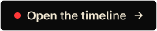

<a id="top"></a>

<div align="center">

<picture>
  <source media="(prefers-color-scheme: dark)" srcset="https://raw.githubusercontent.com/voaneves/timeline/main/assets/logo/logo-dark.svg" />
  <source media="(prefers-color-scheme: light)" srcset="https://raw.githubusercontent.com/voaneves/timeline/main/assets/logo/logo-light.svg" />
  
</picture>

<h1>Super Victor Timeline</h1>

<p>
  <strong>A personal career timeline as a side-scrolling stage: click a pipe to reveal a milestone.</strong><br />
  <sub>Super Mario World style, plain HTML, CSS and JavaScript</sub>
</p>

<p>
  <a href="https://voaneves.github.io/timeline/"><picture><source media="(prefers-color-scheme: dark)" srcset="https://raw.githubusercontent.com/voaneves/timeline/main/assets/buttons/live-dark.svg" /></picture></a>
  <a href="#how-it-works"><picture><source media="(prefers-color-scheme: dark)" srcset="https://raw.githubusercontent.com/voaneves/timeline/main/assets/buttons/how-dark.svg" /></picture></a>
</p>

<p><sub>Need something like this? <a href="https://voaneves.com/en/#contact"><strong>Let's talk →</strong></a></sub></p>

<p>
  <a href="https://github.com/voaneves/timeline/blob/main/LICENSE"></a>
  
</p>

<p>
  <a href="https://voaneves.github.io/timeline/">Live demo</a> ·
  <a href="#how-it-works">How it works</a> ·
  <a href="#running-locally">Running locally</a> ·
  <a href="#project-structure">Structure</a> ·
  <a href="#contact">Contact</a>
</p>

</div>

<picture>
  <source media="(prefers-color-scheme: dark)" srcset="https://raw.githubusercontent.com/voaneves/timeline/main/assets/brand/rule-dark.svg" />
  <source media="(prefers-color-scheme: light)" srcset="https://raw.githubusercontent.com/voaneves/timeline/main/assets/brand/rule-light.svg" />
  
</picture>

## About the project

An interactive timeline of Victor Neves's life and career, presented as a Super Mario World-style side-scrolling stage: click a pipe and Mario walks to it to reveal that milestone.

**Demo:** <https://voaneves.github.io/timeline/>

The page content is in Brazilian Portuguese.

## How it works

- Each milestone is an entry (`year`, `month_name`, `title`) in the `timeline` array in `assets/js/timeline.js`.
- On load, the script creates one pipe (`<li>`) per entry inside the `#events` list. The "Peach" milestone gets its own style.
- Clicking a pipe slides the stage and the ground to that pipe with a CSS transform, plays the walking animation on Mario (left or right, depending on direction) and, when he arrives, activates the pipe to show the milestone.
- Sound effects and the background theme are loaded with the Web Audio API after the first click (`assets/audio/`).
- Other pieces: a light/dark theme toggle (`assets/js/app.js`), a side menu, a custom cursor (`assets/js/cursor.js`), a service worker for caching (`sw.js`, `worker.js`) and a web app manifest (`manifest.json`).

It is a static site: plain HTML, CSS and JavaScript, with no runtime dependencies.

## Running locally

Serve the folder with any static file server (the service worker and audio loading need `http://`, not `file://`). For example:

```sh
python -m http.server 8000
```

Then open <http://localhost:8000/>.

## Project structure

```
index.html        Page markup, meta tags and inline styles
manifest.json     Web app manifest
sw.js, worker.js  Service worker registration and caching
                  (plus .min.js versions)
assets/
  audio/          Sound effects and theme music
  fonts/          Header font
  img/            Icons, logo and social images
  js/             app, cursor, console and timeline scripts
                  (plus .min.js versions)
  styles/         SCSS sources and compiled timeline.css
  logo/           README logo (SVG and PNG)
  buttons/        README buttons
  brand/          README divider and author mark
```

`index.html` loads the `.min.js` versions of the scripts; the unminified files are the sources.

## Contact

<p>
  <a href="https://voaneves.com/en/#contact"><picture><source media="(prefers-color-scheme: dark)" srcset="https://raw.githubusercontent.com/voaneves/timeline/main/assets/buttons/hire-dark.svg" /></picture></a>
  <a href="https://voaneves.com/en/"><picture><source media="(prefers-color-scheme: dark)" srcset="https://raw.githubusercontent.com/voaneves/timeline/main/assets/buttons/site-dark.svg" /></picture></a>
</p>

<a href="https://linkedin.com/in/voaneves">LinkedIn</a> · <a href="mailto:victorneves478@gmail.com">E-mail</a>

<p align="center">
  
</p>

<p align="center"><sub>Released under the <a href="https://github.com/voaneves/timeline/blob/main/LICENSE">MIT License</a>.</sub></p>

<p align="center"><sub><a href="#top">↑ Back to top</a></sub></p>
