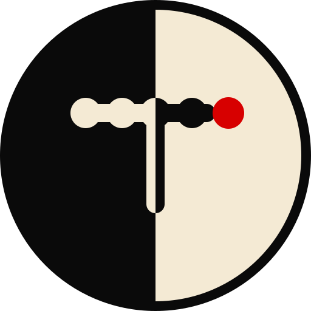
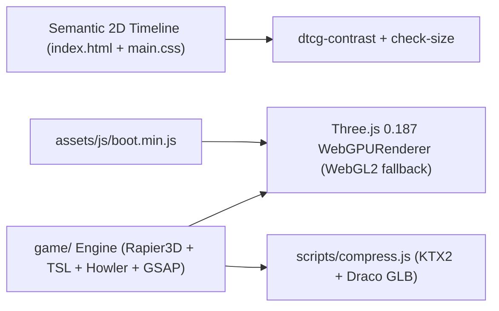
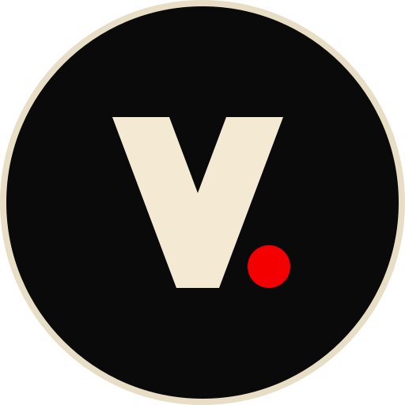

<a id="top"></a>

<div align="center">

<picture>
  <source media="(prefers-color-scheme: dark)" srcset="https://raw.githubusercontent.com/voaneves/timeline/main/assets/logo/logo-dark.svg" />
  <source media="(prefers-color-scheme: light)" srcset="https://raw.githubusercontent.com/voaneves/timeline/main/assets/logo/logo-light.svg" />
  
</picture>

<h1>Victor Neves Timeline</h1>

<p>
  <strong>Semantic 2D career timeline with an interactive 3D diorama &amp; driveable vehicle world built on Three.js WebGPU and Rapier physics.</strong><br />
  <sub>
    Progressive enhancement from accessible HTML/DTCG tokens to 3D physics —
    <kbd>Three.js 0.187</kbd> · <kbd>WebGPURenderer</kbd> · <kbd>Rapier3D WASM</kbd> · <kbd>esbuild</kbd> · <kbd>Vite 8</kbd>
  </sub>
</p>

<p>
  <a href="https://voaneves.github.io/timeline/"><picture><source media="(prefers-color-scheme: dark)" srcset="https://raw.githubusercontent.com/voaneves/timeline/main/assets/buttons/live-dark.svg" /></picture></a>
  <a href="#how-it-works"><picture><source media="(prefers-color-scheme: dark)" srcset="https://raw.githubusercontent.com/voaneves/timeline/main/assets/buttons/how-dark.svg" /></picture></a>
</p>

<p><sub>Need an interactive experience like this? <a href="https://voaneves.com/en/#contact"><strong>Let's talk →</strong></a></sub></p>

<p>
  <a href="https://github.com/voaneves/timeline/blob/main/LICENSE"></a>
  
  
  <a href="./dtcg-contrast.config.json"></a>
</p>

<p>
  <a href="https://voaneves.github.io/timeline/">Live demo</a> ·
  <a href="#about-the-project">About</a> ·
  <a href="#how-it-works">Architecture</a> ·
  <a href="#running-locally">Running Locally</a> ·
  <a href="#project-structure">Structure</a> ·
  <a href="#contact">Contact</a>
</p>

</div>

<picture>
  <source media="(prefers-color-scheme: dark)" srcset="https://raw.githubusercontent.com/voaneves/timeline/main/assets/brand/rule-dark.svg" />
  <source media="(prefers-color-scheme: light)" srcset="https://raw.githubusercontent.com/voaneves/timeline/main/assets/brand/rule-light.svg" />
  
</picture>

<a id="about-the-project"></a>
## About the project

Explore Victor Neves's career milestones either as a lightweight semantic 2D page or inside an interactive 3D Toy Island diorama powered by `Three.js` and `Rapier3D`.

**Live demo:** <https://voaneves.github.io/timeline/>

### Progressive 2D-to-3D Architecture

The root site (`index.html`, `assets/styles/main.css`, `tokens/`) loads fast with accessible semantic HTML and verified W3C DTCG contrast (`dtcg-contrast.config.json`). Alongside it sits the optional WebGPU 3D diorama (`assets/js/world/world.min.js`) and the full Vite-powered 3D world workspace under [`game/`](./game/readme.md).

<a id="how-it-works"></a>
## How it works



<dl>
  <dt><strong>Rendering &amp; TSL Shaders (<code>THREE.WebGPURenderer</code>)</strong></dt>
  <dd>Uses Node-based <code>MeshLambertNodeMaterial</code> shaders with palette textures, directional shadows, water reflections, and radial fog — automatically falling back to WebGL2 on unsupported browsers.</dd>
  <dt><strong>Deterministic Physics &amp; Vehicle Controller (<code>@dimforge/rapier3d</code>)</strong></dt>
  <dd>Simulates a <code>192 × 192 m</code> heightfield island with Rapier WASM rigid-body collisions, 4-wheel suspension, boost trails, ground tracks, keyboard/touch/gamepad inputs, and persistent achievements.</dd>
  <dt><strong>Audio &amp; Quality Tiers</strong></dt>
  <dd>Spatial audio groups and ambient soundtrack powered by <code>Howler.js</code> alongside adaptive desktop/mobile rendering presets (DOF, bloom, shadow resolution).</dd>
</dl>

<a id="running-locally"></a>
## Running locally

### Root 2D Timeline &amp; Diorama Bundle

Requires **Node.js** (`npm run build` bundles `world.min.js` with `esbuild` and validates bundle size and token contrast):

```bash
git clone https://github.com/voaneves/timeline.git
cd timeline
npm install
npm run check          # build world bundle + check size
npm run contrast       # verify dtcg-contrast.config.json
python -m http.server 8000
```

### Full 3D Interactive World (`game/`)

```bash
cd game
npm install
npm run dev            # Vite 8 dev server (HTTPS/WASM)
npm run build          # production bundle -> dist
```

`npm run verify:glb` valida o contrato dos `.glb` (`static/areas/areas.glb` e `static/respawns/respawnsReferences.glb`); com `--strict`, avisos viram erro. Os `.ktx` são gerados por `npm run compress` (exige `toktx`). Status das fases e pendências em [`docs/PLAN-3D.md`](./docs/PLAN-3D.md).

<a id="project-structure"></a>
## Project structure &amp; Licensing

| Path | Role |
| :--- | :--- |
| [`index.html`](./index.html) &amp; `src/` | Semantic 2D timeline entry, PWA manifest &amp; service worker (`worker.js`) |
| `assets/` | Bundled styles (`main.css`), WOFF2 fonts, AVIF headers &amp; `world.min.js` |
| [`game/`](./game/readme.md) | Modular 3D Three.js + Rapier engine, assets &amp; KTX2/Draco compression scripts |
| [`docs/PLAN-3D.md`](./docs/PLAN-3D.md) | Architecture notes and 3D world adaptation roadmap |
| [`LICENSES.md`](./LICENSES.md) | Third-party licenses (`three.js` MIT, Schibsted Grotesk &amp; JetBrains Mono SIL OFL) |

<a id="contact"></a>
## Contact

<p>
  <a href="https://voaneves.com/en/#contact"><picture><source media="(prefers-color-scheme: dark)" srcset="https://raw.githubusercontent.com/voaneves/timeline/main/assets/buttons/hire-dark.svg" /></picture></a>
  <a href="https://voaneves.com/en/"><picture><source media="(prefers-color-scheme: dark)" srcset="https://raw.githubusercontent.com/voaneves/timeline/main/assets/buttons/site-dark.svg" /></picture></a>
</p>

<a href="https://linkedin.com/in/voaneves">LinkedIn</a> · <a href="mailto:victorneves478@gmail.com">E-mail</a>

<p align="center">
  
</p>

<p align="center"><sub>Released under the <a href="./LICENSE">MIT License</a> · Third-party notices in <a href="./LICENSES.md">LICENSES.md</a> · © 2026 <a href="https://github.com/voaneves">Victor Neves</a> · <strong>VOANEVES.</strong></sub></p>

<p align="center"><sub><a href="#top">↑ Back to top</a></sub></p>
